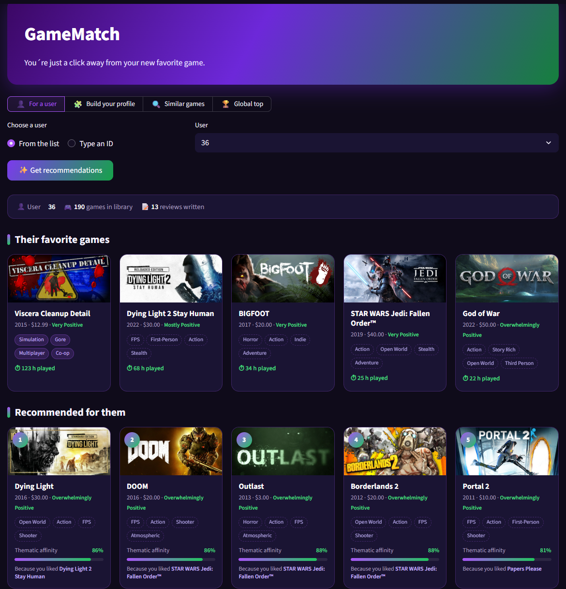

<!-- PROJECT HEADER -->
<br />
<p align="center">
  <!-- Optional: add a logo or banner at images/logo.png and uncomment the next line -->
  <!--  -->

  <h1 align="center">🎮 GameMatch</h1>

  <p align="center">
    A hybrid Steam video game recommender that combines what similar players like with what the games are about.
  </p>
</p>

<p align="center">
  
  
  
  
</p>


<!-- TABLE OF CONTENTS -->
<details open="open">
  <summary><h2 style="display: inline-block">Table of Contents</h2></summary>
  <ol>
    <li>
      <a href="#about-the-project">About The Project</a>
      <ul>
        <li><a href="#how-it-works">How It Works</a></li>
        <li><a href="#results">Results</a></li>
        <li><a href="#dataset">Dataset</a></li>
        <li><a href="#built-with">Built With</a></li>
      </ul>
    </li>
    <li>
      <a href="#getting-started">Getting Started</a>
      <ul>
        <li><a href="#dependencies">Dependencies</a></li>
        <li><a href="#installation">Installation</a></li>
      </ul>
    </li>
    <li><a href="#usage">Usage</a></li>
    <li><a href="#roadmap">Roadmap</a></li>
    <li><a href="#contributing">Contributing</a></li>
    <li><a href="#license">License</a></li>
    <li><a href="#authors">Authors</a></li>
    <li><a href="#acknowledgements">Acknowledgements</a></li>
  </ol>
</details>


<!-- ABOUT THE PROJECT -->
## About The Project

<!-- Add a screenshot of the app at images/screenshot.png and uncomment the next line -->
<!--  -->

**GameMatch** recommends Steam games based on 2 million real user reviews. Plain collaborative filtering on Steam data tends to recommend the same blockbusters to everyone, and its recommendations often have nothing to do with the kind of games a person actually plays. GameMatch tackles both problems with a **hybrid model**:

* **Collaborative filtering (item-item):** "players who liked X also liked Y".
* **Content-based filtering:** thematic similarity computed from Steam's community tags.
* **Popularity penalty:** gives lesser-known games a chance to surface.
* **Explainable results:** every recommendation states which of your games it is based on ("Because you liked *Hollow Knight*").

The project includes a console script with a full offline evaluation and a **Streamlit** web app with four sections:

| Section | What it does |
|---|---|
| 👤 For a user | Shows a dataset user's favorite games and their personalized top 10 |
| 🧩 Build your profile | Pick a few games you like and get recommendations, without being in the dataset |
| 🔍 Similar games | Finds games similar to a chosen one, with a slider from "players in common" to "similar theme" |
| 🏆 Global top | The best rated games among the most popular ones |

### How It Works

1. **Implicit feedback.** Steam has no numeric ratings, only "recommended: yes/no". Reviews are stored in a sparse user × game matrix with a `1` for each positive review. Games a user has already reviewed are never recommended to them.
2. **Collaborative part.** Two games are similar when the same users recommend them (cosine similarity). Only the 100 nearest neighbors of each game are kept, computed in blocks so the 14,000 × 14,000 matrix never has to fit in memory at once.
3. **Content part.** Each game's tags become a TF-IDF vector, with extra weight for the most voted tags, compared with cosine similarity.
4. **Hybrid score.** Each component is standardized (z-score) so they can be combined:

```
score = z(collaborative) + 1.2 · z(content) − 0.3 · z(log popularity)
```

**Data cleaning:** about 570 of the most popular games (Portal 2, GTA V, Cyberpunk 2077…) have an empty tag list in the dataset. Their tags are estimated as the weighted average of the tags of their collaborative neighbors.

### Results

Offline evaluation on the **test set** (70/15/15 train/validation/test split), using 3,000 users and top-10 recommendations. For each user, we check how many of the games they recommended in the test set, which the model never saw during training, appear in their top 10.

| Model | precision@10 | recall@10 | Catalog coverage | Thematic affinity |
|---|---|---|---|---|
| Popularity (baseline) | 0.0131 | 0.047 | 0.1% | 64% |
| SVD (TruncatedSVD) | 0.0192 | 0.067 | 2.9% | 59% |
| Item-item (collaborative) | 0.0313 | 0.114 | 25.3% | 60% |
| Content (tags) | 0.0146 | 0.052 | 17.6% | 78% |
| **Hybrid (1.2 / 0.3)** | **0.0296** | **0.106** | **21.6%** | **74%** |

* The hybrid model gives up a little precision compared with pure item-item in exchange for recommendations that are much more consistent in theme (74% vs 60% thematic affinity).
* A first version of this project, based on SVD over a synthetic 1–10 rating, reached a precision@10 of only 0.007, which is worse than simply recommending the most popular games. Measuring with a ranking metric is what revealed the problem and guided the redesign.

Example: a profile with *Phasmophobia*, *Outlast* and *Resident Evil Village* gets *Outlast 2*, *Resident Evil 7*, *Resident Evil 3* and *Resident Evil 2* as its top recommendations.

### Dataset

[Game Recommendations on Steam](https://www.kaggle.com/datasets/antonkozyriev/game-recommendations-on-steam), by Anton Kozyriev (Kaggle), released under a [CC0: Public Domain](https://creativecommons.org/publicdomain/zero/1.0/) license. After filtering (users with 10 or more reviews, games with 50 or more, and a random sample of 100,000 users), the model uses **2.08 million reviews**, **100,000 users** and **14,010 games**.

| File | Contents | Where to get it |
|---|---|---|
| `games.csv` | Title, release date, Steam rating and price of each game | [Download from Kaggle](https://www.kaggle.com/datasets/antonkozyriev/game-recommendations-on-steam?select=games.csv) |
| `users.csv` | Number of games in each user's library and number of reviews | [Download from Kaggle](https://www.kaggle.com/datasets/antonkozyriev/game-recommendations-on-steam?select=users.csv) |
| `recommendations.csv` | ~41M raw reviews: user, game, recommended (yes/no) and hours played (~2 GB) | [Download from Kaggle](https://www.kaggle.com/datasets/antonkozyriev/game-recommendations-on-steam?select=recommendations.csv) (optional, see below) |
| `filtered_reviews.pkl` | The 2.08M filtered reviews the model is trained on (~29 MB) | ✅ Included in this repository |
| `games_metadata.json` | Description and community tags of each game (~17 MB) | ✅ Included in this repository |

The original CSV files are not redistributed in this repository and must be downloaded from Kaggle (`recommendations.csv` alone is ~2 GB, well above GitHub's 100 MB file limit). The filtered reviews and the game metadata are already included in the `data/` folder.

### Built With

* [Python 3.13](https://www.python.org/)
* [pandas](https://pandas.pydata.org/) and [NumPy](https://numpy.org/): data processing
* [SciPy](https://scipy.org/): sparse matrices
* [scikit-learn](https://scikit-learn.org/): data splitting, normalization and the TruncatedSVD baseline
* [Streamlit](https://streamlit.io/): web app
* [tabulate](https://pypi.org/project/tabulate/): console tables


<!-- GETTING STARTED -->
## Getting Started

Follow these steps to run the project locally.

### Dependencies

All dependencies are listed in `requirements.txt`:

```
numpy==2.3.3
pandas==2.3.3
scipy==1.15.3
scikit_learn==1.7.2
streamlit==1.50.0
pyarrow==18.1.0
tabulate>=0.9
```

> **Note for Windows users:** `scipy` and `pyarrow` are pinned to slightly older versions because Windows Smart App Control blocked the DLLs of their latest releases.

Regenerating `filtered_reviews.pkl` from the raw `recommendations.csv` needs around **2–3 GB of RAM**. Running the app with the included file needs much less.

### Installation

1. Clone the repository
   ```sh
   git clone https://github.com/YOUR_USERNAME/GameMatch.git
   cd GameMatch
   ```
2. (Optional) Create and activate a virtual environment
   ```sh
   python -m venv .venv
   .venv\Scripts\activate        # Windows
   source .venv/bin/activate     # macOS / Linux
   ```
3. Install the dependencies
   ```sh
   python -m pip install -r requirements.txt
   ```
4. Download `games.csv` and `users.csv` from the [Kaggle dataset](https://www.kaggle.com/datasets/antonkozyriev/game-recommendations-on-steam) and copy them into the `data/` folder. `filtered_reviews.pkl` and `games_metadata.json` are already there.

   `recommendations.csv` (~2 GB) is **optional**: the model is trained on the already filtered reviews included in `data/filtered_reviews.pkl`. You only need it if you want to change the filters and regenerate that file (see [Parameters](#parameters)).

   Your `data/` folder should look like this:
   ```
   data/
   ├── README.md
   ├── filtered_reviews.pkl     # included
   ├── games_metadata.json      # included
   ├── games.csv                # download from Kaggle
   ├── users.csv                # download from Kaggle
   └── recommendations.csv      # optional, download from Kaggle
   ```


<!-- USAGE -->
## Usage

### Web app

```sh
python -m streamlit run app.py
```

The app loads the filtered reviews from `data/filtered_reviews.pkl` and trains the model when it starts, which usually takes less than a minute. The trained model is then kept in memory while the app is running.

<!-- Add screenshots of each section here, for example: -->
<!--  -->
<!--  -->

### Console

```sh
python main.py
```

It prints the evaluation table above plus examples: a known user's favorites and recommendations, the global top for an unknown user, a hand-made horror profile and the games most similar to *Portal 2*.

### Using the model in your own code

```python
from recommender import build_model

model, games, users = build_model()

# Recommendations for someone who likes these games
liked = [model.find_game(t) for t in ["Hollow Knight", "Celeste", "Stardew Valley"]]
print(model.recommend_from_games(liked, top_n=10)[["title", "tags", "affinity", "because_you_liked"]])

# Games similar to a given one
print(model.similar_games(model.find_game("Portal 2"), top_n=5))
```

### Parameters

They are defined at the top of `recommender.py`:

| Parameter | Default | Description |
|---|---|---|
| `MIN_USER_REVIEWS` | 10 | Minimum number of reviews per user |
| `MIN_GAME_REVIEWS` | 50 | Minimum number of reviews per game |
| `MAX_USERS` | 100,000 | User sample size (to keep memory under control) |
| `NEIGHBORS` | 100 | Similar games stored for each game |
| `CONTENT_WEIGHT` | 1.2 | Weight of the thematic part |
| `POPULARITY_WEIGHT` | 0.3 | Penalty for very popular games |

If you change the filters, download `recommendations.csv` from Kaggle and delete `data/filtered_reviews.pkl`: the next run reads the raw reviews (this takes several minutes) and saves a new filtered file. Set `TUNE_WEIGHTS = True` in `main.py` to try other weight combinations on the validation set.

### Project structure

```
├── recommender.py       # Data loading, cleaning, hybrid model, recommendations and evaluation
├── main.py              # Console run: evaluation and examples
├── app.py               # Streamlit web app
├── .streamlit/
│   └── config.toml      # App color theme
├── data/                # filtered_reviews.pkl + games_metadata.json included; CSVs from Kaggle
└── requirements.txt
```


<!-- ROADMAP -->
## Roadmap

- [ ] Time-based evaluation split (train on older reviews, test on newer ones)
- [ ] Try implicit matrix factorization (ALS) as an extra collaborative component
- [ ] Fill in the missing tags from the Steam store instead of estimating them
- [ ] Deploy a demo on Streamlit Community Cloud with a reduced dataset
- [ ] Add unit tests for the recommender

See the [open issues](https://github.com/LauraRodriguez91/games-match/issues) for a list of proposed features and known issues.


<!-- CONTRIBUTING -->
## Contributing

Contributions are what make the open source community such an amazing place to learn, inspire, and create. Any contributions you make are **greatly appreciated**.

1. Fork the project
2. Create your feature branch (`git checkout -b feature/AmazingFeature`)
3. Commit your changes (`git commit -m 'Add some AmazingFeature'`)
4. Push to the branch (`git push origin feature/AmazingFeature`)
5. Open a pull request


<!-- AUTHORS -->
## Authors

**Laura Rodríguez Marín**: Junior AI/ML Developer

* GitHub: [@LauraRodriguez91](https://github.com/LauraRodriguez91)
* LinkedIn: https://www.linkedin.com/in/laura-rodríguez-b862b5232
* Email: laurarodriguezmarin91@gmail.com

Project link: https://github.com/LauraRodriguez91/games-match


<!-- ACKNOWLEDGEMENTS -->
## Acknowledgements

* [Anton Kozyriev](https://www.kaggle.com/antonkozyriev), for the *Game Recommendations on Steam* dataset
* [Steam](https://store.steampowered.com/), for the game header images shown in the app


## Thank you

Thanks for checking out GameMatch! If you find it useful, consider giving the repository a ⭐.
